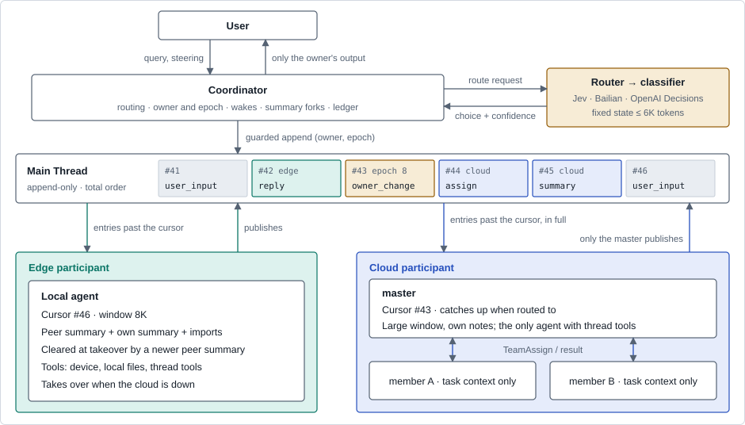
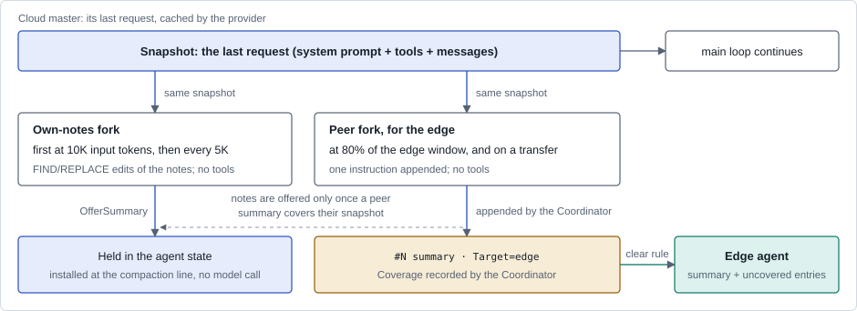
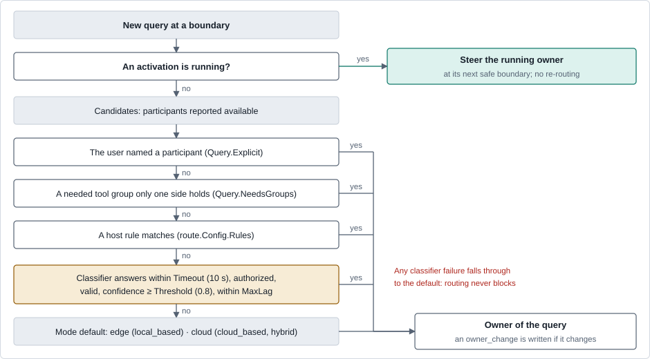
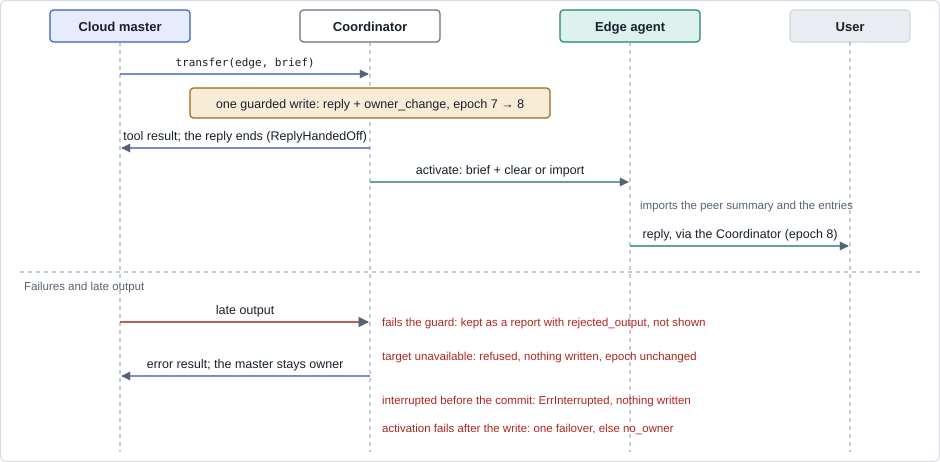
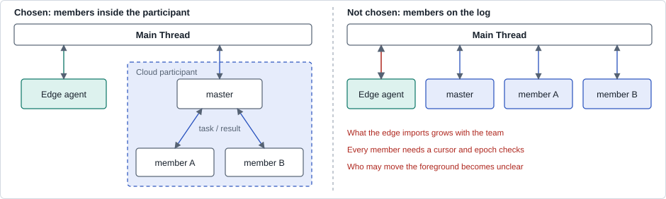

# Main Thread design

Status: design of the experimental `thread` packages as implemented on this
branch. The [Main Thread guide](../main-thread.md) explains how to use them;
this note explains why they are shaped the way they are, what they replace,
how they behave across failures, and what is left open. Every exported
identifier in these packages is EXPERIMENTAL. The repository tests are
offline, with scripted models; the evidence section says what was measured
and on what.

Code references to `main` are to commit
[`ce51d23`](https://github.com/agentscope-ai/agentscope-go/tree/ce51d23).

## Contents

1. [The problem](#1-the-problem)
2. [Goals and non-goals](#2-goals-and-non-goals)
3. [Architecture](#3-architecture)
4. [The log](#4-the-log)
5. [Three windows](#5-three-windows)
6. [Context and summaries](#6-context-and-summaries)
7. [Routing](#7-routing)
8. [Transfer and the other thread tools](#8-transfer-and-the-other-thread-tools)
9. [Working at the same time](#9-working-at-the-same-time)
10. [A cloud master with sub-agents](#10-a-cloud-master-with-sub-agents)
11. [An end-to-end example](#11-an-end-to-end-example)
12. [Failure, recovery and durability](#12-failure-recovery-and-durability)
13. [Accounting](#13-accounting)
14. [Deployment](#14-deployment)
15. [A managed cloud agent (future direction)](#15-a-managed-cloud-agent-future-direction)
16. [Comparison with existing approaches](#16-comparison-with-existing-approaches)
17. [Evidence](#17-evidence)
18. [Changes outside the new packages](#18-changes-outside-the-new-packages)
19. [Risks and open questions](#19-risks-and-open-questions)

## 1. The problem

A device runs a small local model (stage 0 used a 4B model with an 8K
window); the cloud runs a model whose window is a hundred times larger. Both
should do real work, with tools, in one session that the user experiences as
continuous. The device holds device tools and must keep serving when the
cloud is unreachable. The cloud is the stronger model and should keep using
its window.

### What `main` offers

| Path on `main` | Unit of switching | Agents and tools | Continuous session | What stops it here |
|---|---|---|---|---|
| `ConnectivityAwareModel` | One model call, by connectivity and a circuit breaker | Yes | Yes | Cloud first; the local model works only after failures. The window is the smaller of the two ([model.go:196-199](https://github.com/agentscope-ai/agentscope-go/blob/ce51d23/pkg/agentscope/model/model.go#L196-L199)) |
| `tierrouter.ChatRouter` | One operation | Refuses tools ([chatmodel.go:174-176](https://github.com/agentscope-ai/agentscope-go/blob/ce51d23/pkg/agentscope/tierrouter/chatmodel.go#L174-L176)) | Buffered `Reply` only | No tool session can use it |
| `managedtask.Router` | One task: rules, then a classifier, then qualified pools | Text only, no Agent | No | Routes fixed text tasks, not a session |
| `UnifiedAgent.Spawn`, `runtime.AgentManager` | A host call | Yes | No: one-shot sub-agents | The result returns to the caller; the sub-agent does not continue with the user |
| `pipeline.TeamPipeline` | Leader assignment | Yes | Within one run; each `Start` builds a fresh leader | Serial, results return to the leader |

A host can compose a two-tier session from these parts: a `ChatModel` that
switches per turn, a `TeamPipeline` with a local member, or two agents with a
handoff. Each composition runs into one of the following.

- **One history, one window.** When both models share a history, the
  agent's compression window is the smaller one: the agent resolves its
  window to the minimum over a `ConnectivityAwareModel`'s members and over a
  configured fallback model
  ([compress.go:313-321](https://github.com/agentscope-ai/agentscope-go/blob/ce51d23/pkg/agentscope/agent/compress.go#L313-L321)).
  The cloud then works from an 8K compression of a session it could hold
  whole.
- **Window checks send everything to the cloud.** A single history that
  sends any call over the device's window to the cloud, #67's context-bound
  check in its simplest form, keeps the cloud's view whole. But a single
  history only grows, so once it outgrows the device's window, later calls no
  longer fit and go to the cloud: on a long session, all-cloud after the
  first few turns.
- **The cloud's summary does not fit the device.** The default summary
  budget is 1/32 of the window, clamped to [1,024, 8,192]
  ([compress.go:41-49](https://github.com/agentscope-ai/agentscope-go/blob/ce51d23/pkg/agentscope/agent/compress.go#L41-L49)).
  For a 200K cloud window that is 6,250 tokens, nearly the 6,553-token
  compression line of an 8,192-token device window (trigger ratio 0.8).
- **Compression replaces state in place.** `state.Summary` and
  `state.Context` are overwritten
  ([compress.go:492-493](https://github.com/agentscope-ai/agentscope-go/blob/ce51d23/pkg/agentscope/agent/compress.go#L492-L493)),
  so two sides sharing state cannot each keep their own. A failed summary
  falls back to truncation that keeps the previous summary
  ([compress.go:444-451](https://github.com/agentscope-ai/agentscope-go/blob/ce51d23/pkg/agentscope/agent/compress.go#L444-L451)).
- **Compression is a separate request.** It rebuilds the messages
  (`buildCompressionMessages`,
  [compress.go:1015](https://github.com/agentscope-ai/agentscope-go/blob/ce51d23/pkg/agentscope/agent/compress.go#L1015))
  and forces a tool choice through structured output
  ([structured_output.go:89-91](https://github.com/agentscope-ai/agentscope-go/blob/ce51d23/pkg/agentscope/model/structured_output.go#L89-L91)).
  It is not the main request plus one instruction, so it cannot reuse that
  request's cached prefix.
- **Separate histories with a handoff summary.** Each side keeps its own
  context and writes a summary at every switch. Each switch loses whatever
  the summary leaves out, and nothing records what the other side did unless
  that side reports it. A handoff also has no owner while it is in flight.

## 2. Goals and non-goals

| Goals | Non-goals |
|---|---|
| One session switches between cloud and device per query, and the cloud keeps its large window | Exactly-once tool effects. After a crash, effects are marked unknown; nothing re-runs automatically |
| Each side keeps its own context, tools and permissions, and knows what the other can do | A multi-writer log or distributed consensus. There is one sequencer |
| A handover that does not return to the caller, and background work on the other side while the owner talks to the user | Replacing `managedtask` for fixed text tasks |
| The cloud side may be a master with sub-agents, without changing the device's view | Real-time hardware control or physical safety guarantees |
| The device can take over when the cloud is down | A privacy boundary. Every participant reads every entry ([design note](main-thread-privacy.md)) |
| The thread packages are opt-in and EXPERIMENTAL; four default-behavior changes outside them are listed in section 18 | Verifying more than two top-level participants. The structure allows it; nothing tests it |

## 3. Architecture



*Figure 1. The participants coordinate through the log, which only the
Coordinator writes; the opt-in event list and a shared workspace are the
exceptions. Members stay inside the cloud participant and never touch the
log. Cursors and entries are an example.*

| Layer | Responsibility | Code |
|---|---|---|
| Coordinator | Routes each query, keeps the owner and its epoch, forwards only the owner's foreground events, commits thread-tool writes, wakes participants, schedules summary forks, keeps the ledger. It is ordinary deterministic code; it asks a classifier only through the router | `thread/coordinator*.go` |
| Log | Total order, persistence, reads past a cursor | `thread/store.go`, `thread/filestore.go`, `thread/entry.go` |
| Projection | Renders entries into a participant's context within its budget | `thread/projection.go`, `thread/coordinator_import.go` |
| Participant | One agent or a team that behaves as one member | `thread/participant` |
| Router | Modes, rules and the classifier layer | `thread/route` |
| Model calls | Retries and same-tier fallback inside a participant | Existing `FallbackChatModel`, `ModelConfig.FallbackModel` |

**Cross-tier switching goes only through the thread.** Configuring the local
model as the cloud agent's fallback would shrink the cloud's compression
window to the local one (section 1), which defeats the design. Inside a
participant, configure only same-tier fallback.

**Participants use `ReplyStream`.** The loop bridge cannot carry interactive
confirmation or external-tool events, and the thread's writing tools are
external tools. The loop bridge cannot hand the foreground over.

## 4. The log

### The log holds only what was published

This is the decision the rest depends on. Tool calls, tool results and
thinking stay inside the agent that produced them. An entry holds the text
the user saw and a digest of each tool call (its name and arguments, cut at
200 runes, never its output).

- **Two contexts stay two contexts.** If trajectories entered the log, the
  design would collapse into one shared history, with the window problem of
  section 1.
- **Nothing provider-specific crosses over.** Tool-call/result pairs and
  thinking blocks would otherwise have to be migrated between providers.
- **Imports stay small.** What a handover brings is published text and
  summaries, not trajectories.

The receiver therefore cannot see the other side's tool outputs. Four
mechanisms make up for that: the peer summary, written by a cloud fork that
saw the full trajectory (section 6); the tool digest; artifact references;
and the read-only `thread_read` tool. A fifth, the event list, is opt-in
because stage 0 found no clear difference with it.

### Entry kinds

| Kind | Written for | Content | Wakes |
|---|---|---|---|
| `user_input` | the user | A user message | The owner |
| `reply` | a participant's run | The text the user actually saw, and the tool digest | Nobody |
| `summary` | a cloud fork | A summary for a target window, with its budget and the entries it covers | Nobody |
| `owner_change` | the router, a transfer, a failover or the user | New owner, reason (`router`, `transfer`, `failover`, `user`), the brief of a transfer. Starts a new epoch | The new owner |
| `assign` | `assign_task` | A background task for a participant | The assignee |
| `report` | `report`, a finished task, late output | Progress or a result | Its recipients, only when `Notify` is set |
| `artifact` | `publish_artifact` | An artifact reference | Nobody |
| `progress` | a run's plan updates | The run's newest plan; a projection shows only the newest of a run still going, or of one that failed | Nobody |
| `marker` | the Coordinator | `interrupted`, `recovered`, `restarted`, `failed`, `unknown_effects`, `no_owner`, `rejected_output` | By kind |

```go
// thread/entry.go (abridged)
type Entry struct {
    Seq      uint64                 // assigned by the single sequencer
    Epoch    uint64                 // the owner epoch at write time
    Kind     Kind
    Origin   Origin                 // the writer; empty means the Coordinator
    To       []string               // participants to wake; empty only syncs
    BasedOn  uint64                 // the newest entry the writer had read
    Content  []message.ContentBlock // never tool calls, results or thinking
    Digest   *ToolDigest            // tool names and arguments, cut at 200 runes
    Refs     []ArtifactRef
    Coverage *Coverage              // on a summary: Through, Excluded
    Summary  *SummaryMeta           // on a summary: Target, Budget, Lossy
    Owner    *OwnerChange           // From, To, Reason, Brief
    Task     *Task                  // on an assign: ID, Notify
    Marker   *Marker
    Notify   bool
    Run      string                 // on progress: the activation it reports on
    Steered  []uint64               // on the entry ending a run: inputs it took besides its trigger
    DedupKey string                 // idempotent retries and recovery markers
    Time     time.Time
}

type Coverage struct {
    Through  uint64   // every entry up to here is covered, except Excluded
    Excluded []uint64
}
```

The Coordinator records `Coverage` when it starts a fork, from the cloud's
cursor and the entries others wrote after it. It is never inferred from the
summary text.

### Invariants

These are stated in [`thread/doc.go`](../../pkg/agentscope/thread/doc.go) and
held by `coordinator_invariants_test.go`:

1. One sequencer, total order.
2. Entries are immutable; corrections are new entries.
3. The current owner is the target of the last `owner_change` entry, so it
   can be rebuilt by replaying the log.
4. Only the current owner's foreground activation reaches the user. Writes
   the user can see carry a guard with the owner and the epoch; a stale write
   fails with `ErrNotOwner`. Background reports, artifacts and assigns are
   not guarded by epoch, so a legitimate report can still land after the
   owner changed.
5. A participant's cursor and the content imported up to it change in one
   state update and one checkpoint (`AgentState.ThreadCursor`, checkpoint
   schema 3).
6. Entries are never stranded: after every activation the Coordinator checks
   for entries addressed to the participant past its cursor, and activates it
   again if there are any.

### Knowing the other side

Each participant has a `Descriptor`: name, zone (`edge` or `cloud`),
description, window, the budget of a summary written for it, the longest
brief it accepts and its tool groups. Peers see each other's descriptors in
their system prompt (`participant.SystemPromptSection`), and the router uses
them as the classifier's options.

## 5. Three windows

Three context windows are involved, and each is bounded on its own. The
figures assume stage 0's configuration: an 8,192-token edge window and the
documented defaults.

| | Cloud | Edge | Classifier |
|---|---|---|---|
| **Window** | The cloud model's | 8,192 in stage 0 | The classifier's prompt (8,192 for Piccolo) |
| **What fills it** | Its own full context, with its own notes in place of older history | Peer summary, own summary, imports and the current turn | A fixed-size state |
| **Summary written for it** | Own notes, capped at `OwnMaxTokens` (8,192) | Peer summary within `Descriptor.SummaryBudget`, or 5/6 of the summary total (2,560) | None; with `IncludeHistory` it reads the peer summary |
| **Who writes it** | The cloud's own-notes fork | Peer summary: the cloud's peer fork. Own summary: the edge's synchronous compression | — |
| **When** | First at 10,000 input tokens (`OwnInit`), then every 5,000 (`OwnEvery`); installed at the compaction line | When a handover's load reaches 80% of the edge window (`PeerRatio`), and on a transfer to the edge | Each query the earlier routing steps leave open |
| **Summary total** | — | `ThreadSummaryTokens`: 3/8 of the window (3,072), shared by the own and the peer summary | Query 1,500; recent 1,500; participants 300; total 6,000 |
| **Imports** | In full | Up to half the window (`EdgeShare` 0.5); chunked, up to 8 rounds (`MaxRounds`), when that does not fit | — |
| **Reads** | Every entry | Every entry | The query and descriptors; with `IncludeHistory`, also the peer summary, recent entries and lag |

The edge's summary total is a share of its window, not of the default
compression budget. A peer summary arriving at the edge elides an older own
summary to what the peer summary leaves, and it no longer eats the recent
tail's `ReserveRatio` share, so the recent turns survive a handover.

## 6. Context and summaries



*Figure 2. Both summaries come from forks of the cloud's last request. The
main context is never touched by a fork. The edge never forks.*

### Forks reuse the cloud's last request

A fork is the cloud's last request plus one appended instruction, with the
same system prompt, tools and options and an output cap. A provider with
prefix caching can therefore reuse the cached prefix. Small live tests in
stage 0 saw such forks hit the cache on the OpenAI Responses API; the branch
has not measured it. The fork sends tool choice `none` by default. Some providers
(Anthropic) invalidate cached blocks when the tool choice changes, so
`KeepForkToolChoice` keeps the main request's tool choice and asks the model
to rewrite if it calls a tool. `ForkGuard` runs the host's guardrail rules on
every summary a fork writes, since a fork does not pass through the reply
loop. A summary over budget is sent back for one rewrite; one still over it
is cut and marked `Lossy`.

### Peer summary, for the edge

At the end of a cloud reply, the Coordinator measures what a handover would
bring the edge: its newest peer summary, the entries after it, and what the
reply added. When that reaches `PeerRatio` (0.8) of the edge's window, the
peer fork writes a new summary. A transfer to the edge also forces one. The
edge can therefore always take over within its window, failover included,
when the cloud can no longer fork. `PeerEvery` adds a fixed refresh interval
and defaults to 20,000 tokens only when the edge's window is unknown.

Alternative considered: a fixed refresh every 20K tokens. The load rule
writes when a takeover would no longer fit, not on a timer.

### Own notes, for the cloud

The cloud's own history is handled the same way as the peer summary, from the
same last request. The first notes are written once the cloud's input reaches
10,000 tokens, in fixed sections: task, current state, files and identifiers,
decisions, errors and fixes, next steps. Each 5,000 tokens of growth, an
update fork receives the current notes and answers only with FIND/REPLACE
edits or `NO CHANGES`. An answer that is neither never replaces the notes.

The notes are not applied when written. The Coordinator offers them to the
agent (`OfferSummary`), which saves the offer with its state and installs it
when its context reaches its compaction line, without a model call. It keeps
a recent tail with intact tool pairs and everything after the notes'
snapshot. Two rules keep this safe:

- **Notes wait for a covering peer summary.** Once notes replace the
  history, its tool work could no longer reach the edge. So notes are offered
  only after a peer summary covers their snapshot, and near the compaction
  line the peer fork runs on the same snapshot.
- **A stale offer falls back.** When the offer no longer matches the
  context, or the context is still at the line after the notes are in, the
  agent compresses synchronously, as it would without notes.

Alternative considered: rewriting the cloud's whole summary near the
compaction line. With incrementally edited notes, the cloud's compaction
never waits on a model call when an offer is ready.

### The edge's context

- **Clear rule.** When the edge is about to run after another participant
  held the foreground since the edge last acted, and the newest peer summary
  is newer than the edge's last activity, the edge's context is replaced in
  one update that goes with the activation: the peer summary plus the
  entries it does not cover. The summary speaks for the older context. An
  edge that kept the foreground, for example while the cloud ran a background
  task for it, is not cleared. Stage 0 measured keeping the local context at
  a takeover against clearing it, and found no clear difference:
  −0.7 [−19.8, +18.5] points as scored.
- **Incremental import.** Otherwise the edge imports the entries past its
  cursor, within `EdgeShare` of its window.
- **Chunked import.** When an import does not fit, because no newer peer
  summary exists (the cloud is down, say), the Coordinator imports in chunks
  and compacts between them with `CompactStrict`, which leaves the state
  unchanged on any failure. After `MaxRounds` it moves on and tells the edge
  which entries to read with `thread_read`.
- **Edge compression.** The edge's own summary comes from its agent's
  synchronous compression in its reply loop. Nothing forks on the edge. Whether an
  asynchronous summary of the edge's own context, written by the cloud,
  would do better on a 4B model is an open evaluation (section 19).

### What the cloud sees

The cloud imports every entry it lacks, in full, and compacts in its own
window. It never sees the edge's tool outputs, only its published text and
digests, unless the host turns on the opt-in event list.

## 7. Routing

### Modes

| | `local_based` | `cloud_based` | `hybrid` |
|---|---|---|---|
| **Home** | The edge | The cloud | None |
| **The classifier decides** | Whether to go to the cloud, for stronger reasoning or cloud-only tools | Whether to go to the edge, for simple requests or device-only tools and data | The best participant per query |
| **Default, when nothing decides** | The edge | The cloud | The cloud, whoever owns the session; the edge only when the cloud is not a candidate |
| **Suits** | Device-first deployments, often offline | Quality first; the device serves offline and device tools | Cost and quality both matter |
| **Main risk** | Hard requests stay on the small model | The edge rarely works | Import cost when the owner switches often |

The `hybrid` default was originally to stay with the current owner. Partial
results of a withdrawn stage 0 comparison showed that default kept 98% of
turns on the edge, because the first undecided query went to the edge and
stayed there. The default is now the cloud.

### Decision order



*Figure 3. The router never blocks on the classifier: every classifier
failure falls through to the default.*

- **Named participants and tool groups.** The host sets `Query.Explicit` when
  the user addresses a participant, and `Query.NeedsGroups` when the query
  needs a tool group; a group only one side holds decides the owner.
- **Availability.** `thread.Config.Available` reports which participants
  can run. With the cloud offline, the edge is the only candidate. A cloud
  that is unreachable but reported available still gets an open query, and
  the edge gets it only after that run fails and failover moves it.
- **Query boundaries only.** A message sent while a reply runs never
  re-routes: it steers the running owner at its next safe boundary (after a
  tool step, before the next model call). Only a transfer or a failover
  changes the owner mid-query.
- **The classifier** is any `classifier.DispatchClassifier`: Jev (and
  Piccolo through the Jev adapter), Bailian, OpenAI Decisions or the offline
  fake. It gets one Choice question whose options are the participants'
  descriptors. Its call is bounded by `Timeout` (10 s by default), its
  dispatch is checked by `Authorize`, its answer needs a confidence of at
  least `Threshold` (0.8 by default), and it may not pick a participant more
  than `MaxLag` entries behind. Each of these failures falls through to the
  default, which still gets the query when it is behind and imports what it
  lacks.

### The classifier's state

| Field | Budget | Content |
|---|---|---|
| Query | 1,500 | The current input, cut in the middle when long |
| Participants | 300 | Names, zones, windows, availability and tool groups |
| Peer summary (with `IncludeHistory`) | Within the total | The summary the cloud wrote for the edge window |
| Recent (with `IncludeHistory`) | 1,500 | Recent published entries as text, with the names of the tools each reply used |
| Lag and ownership (with `IncludeHistory`) | Within participants | Each participant's lag and whether it owns the session |
| **Total** | **6,000** | Fits Piccolo's 8,192-token prompt with the question and options |

`IncludeHistory` is off by default. The classifier then sees what a
classifier routing from the query alone sees, as stage 0's stand-in did. The
history's effect on routing quality has not been measured. A hosted
classifier reads whatever the state holds, and the question carries no
warning about it; `route.BuildState` returns the exact state for logs.

## 8. Transfer and the other thread tools

| Tool | Foreground owner after | The caller after | The receiver |
|---|---|---|---|
| `transfer(to, brief)` | The receiver | Its reply ends (`ReplyHandedOff`) | Starts with the brief and takes the next user message |
| `assign_task(to, task, notify)` | Unchanged | Keeps working | Runs in the background; its final answer becomes a `report` |
| `report(text, to, task_id, notify)` | Unchanged | Keeps working | Sees it at its next boundary; an idle owner is woken only with `notify` |
| `publish_artifact(uri, summary, size, text)` | Unchanged | Keeps working | Sees the reference |
| Routing switch (no model involved) | The router's target | Already idle | Handles the current query |
| `thread_read`, `event_read` | Read-only | — | — |

A transfer and a routing switch write the same `owner_change` entry and
differ only in `reason`. A routing switch has no brief; the receiver relies
on the summary and the entries it imports.



*Figure 4. Ownership changes when the log write commits. A late write from
the old owner fails its guard. The receiver's reply reaches the user through
the Coordinator.*

- **The brief is structured:** goal, done, remaining, constraints and
  references. The receiver's `BriefMaxRunes` bounds it.
- **A transfer is always called alone** (`agent.WithExclusiveTools`). A tool
  cannot see the other calls in its batch, so the agent checks the batch
  before dispatch and makes the model send it again alone.
- **Ending the caller's reply needed a new reason.** The existing reasons do
  not fit. With an external tool the model would continue after the result.
  A cancel ends as `interrupted`, and under a `Conversation` it records a user
  interrupt and denies waiting confirmations. `types.ReplyHandedOff` ends the
  reply with no further model call, and `OnReply` middleware cannot swallow
  it, like an interrupted end.
- **What the user saw is sealed with the change.** The caller may stream text
  before calling `transfer`. The Coordinator writes that text as a `reply` in
  the same guarded write as the `owner_change`, so the receiver imports what
  the user just read.
- **A transfer never waits for a fork.** The receiver starts from the newest
  summary, the entries and the brief.
- **An interrupted write is refused.** A transfer, task, report or artifact
  that had not committed when `Interrupt` arrived returns
  `thread.ErrInterrupted`; nothing is written and the model is told so.

## 9. Working at the same time

The two participants are independent `UnifiedAgent`s with their own
confirmation and external-tool channels, so they are not bound by
`TeamPipeline`'s serial barrier. Only the owner talks to the user; a
background participant reports through `report`, and the owner decides what
to tell the user.

| Problem | Handling |
|---|---|
| Side effects on shared resources | The log does not arbitrate. Tool sets rarely overlap; `participant.Leased` wraps tools that touch a shared resource (a file path, a device) with a lease renewed while the call runs |
| Two agents on one workspace | Each agent gets its own `tool.ReadCache` with `SetRejectStaleWrites(true)`: a whole-file write over a version the agent never read is refused, and it reads again. This includes a team's members |
| Deciding on a stale view | Entries record `BasedOn`; new information arrives at the next boundary, and the model decides. Nothing merges automatically |
| Waking each other | Only `To` wakes; reports wake only with `notify`; at most 4 wakes of an idle owner per query (`MaxWakesPerQuery`) and nested tasks 2 deep (`MaxAssignDepth`) |
| Queued user input | At most 16 inputs wait for a cycle (`MaxPendingInputs`); inputs parked after a `no_owner` or `recovered` marker do not count, and the oldest beyond the bound is retired and stays as context |
| Confirmations from the background | Events carry their origin and `Foreground: false`; the host shows them without changing the owner and answers with `SubmitUserConfirm`. A background request has no timeout yet |
| Progress | `update_plan` calls become `progress` entries of their run, so a failover or restart sees where the run stood |
| Safe injection | Steering and boundary input arrive only where no tool call awaits its result, so a tool-call/result pair is never split |

## 10. A cloud master with sub-agents



*Figure 5. With members inside the participant, the log's membership does
not grow with the team, and neither does what the edge must import.*

`participant.TeamParticipant` runs the cloud side as a master with members
through `pipeline.TeamPipeline`. Each activation starts a team run whose
leader factory rebuilds the master from its persisted state and installs
`TeamAssign`, the thread tools and the participant's agent options.
`TeamConfig.Load` reads that state, so a participant rebuilt after a restart
reports the right cursor before its first activation.

| Topic | Rule |
|---|---|
| Membership | The participant is the log's member. Only the master holds a cursor, notes and thread tools |
| Members' input | Members get only the tasks the master writes. They never see the thread and never get thread tools |
| Crossing the boundary | Members cannot transfer or assign across the boundary. A need for device work goes back to the master, which assigns it |
| Publishing | A member's result is a tool result in the master's context; the master decides what to publish. Member tool calls appear in the digest as `member/tool` |
| Ledger | Member usage is recorded under the cloud participant, by path |
| Summaries | Forks start only from the master; members' work reaches a summary through the master's context. Notes that finish after the next activation has built its master are offered to that master, which matches them by message ID |
| Handed-off ends | `TeamRun` treats the leader's `ReplyHandedOff` as a normal end |
| Recovery | The master is rebuilt from its checkpoint; after a crash it gets the `restarted` input and checks the actual state (section 12) |

Members run serially, as `TeamPipeline` does today. Parallel members would
change only the inside of the cloud participant; concurrency between the
cloud and the edge comes from `assign_task`.

## 11. An end-to-end example

A user debugs a service crash on their device. The mode is `hybrid`; the edge
holds the `device` tool group. Rows in italics are actions inside a participant
that do not enter the log. The origin column shows what the entry records:
a participant's name, `user`, or `coordinator` for entries the Coordinator
writes on its own.

| Seq | Epoch | Kind | Origin | Content |
|---|---|---|---|---|
| 101 | 7 | `user_input` | user | "The service crashed last night. Find out why and propose a fix." |
| 102 | 8 | `owner_change` | coordinator | cloud → edge, `reason=router`: the host marked the query as needing the `device` tool group (`Query.NeedsGroups`), which only the edge holds |
| 103 | 8 | `reply` | edge | "Out of memory on host-a17; the heap grows steadily." Digest: `read_log` ×4, `grep` ×2 |
| 104 | 9 | `owner_change` | edge | edge → cloud, `reason=transfer`. Brief: goal, find the defect and a patch; done, OOM and growth confirmed; references, the log excerpt |
| | | | | *Cloud master imports 101–104, then `TeamAssign` member-a (code search) and member-b (reproduction)* |
| 105 | 9 | `progress` | cloud | Plan: search the cache code (done), reproduce (in progress), write the patch |
| 106 | 9 | `artifact` | cloud | `patch-17.diff` with a summary and size |
| 107 | 9 | `reply` | cloud | "The cache has no bound; patch-17 adds one." Digest: `TeamAssign` ×2, `member-a/grep` ×3, `member-b/run_test` |
| 108 | 9 | `summary` | cloud (fork) | Peer summary for the edge, `Coverage{Through: 107}`: the handover load reached 80% of the edge window |
| 109 | 9 | `user_input` | user | "Apply it on the device and run the tests." |
| 110 | 10 | `owner_change` | coordinator | cloud → edge, `reason=router`: the host marked the query as needing `device` |
| | | | | *The cloud held the foreground since the edge last acted (103), and #108 is newer, so the edge is cleared: its context becomes #108 plus #109–110* |
| 111 | 10 | `assign` | edge | To cloud, `notify`: "Look for other unbounded caches in the service." |
| 112 | 10 | `reply` | edge | "Applied; 3 of 3 tests pass." Digest: `apply_patch`, `go_test` |
| | | | | *The cloud runs the task in the background; its events are not shown to the user* |
| 113 | 10 | `report` | cloud | To edge, `notify`: "The session store has the same pattern." Wakes the idle owner (1 of 4 wakes) |
| 114 | 10 | `reply` | edge | "The cloud found a second unbounded cache in the session store." |
| 115 | 10 | `user_input` | user | "Patch the session store too and explain the change." |
| 116 | 11 | `owner_change` | coordinator | edge → cloud, `reason=router`: no rule matched and the classifier was not confident, so the `hybrid` default, the cloud |
| 117 | 11 | `progress` | cloud | Plan: patch written (done), explanation (in progress) |
| 118 | 11 | `reply` | cloud | The text the failed run had streamed, sealed with its digest: `write_file` |
| 119 | 11 | `marker` | coordinator | `failed`: the cloud's model call failed |
| 120 | 11 | `marker` | coordinator | `unknown_effects`: the failed run had called tools |
| 121 | 12 | `owner_change` | coordinator | cloud → edge, `reason=failover`. The edge's input is one line pointing at #119 and the progress #117; the edge imports incrementally (#108 is older than its last activity) |
| 122 | 12 | `reply` | edge | "The cloud stopped mid-way; the session-store patch is written but not applied. Applying it now." |

The failover note follows a fixed format:

```
[cloud failed: <reason> (#119). You now answer the user: continue their request #115 "<the request, at most 120 characters>" from where cloud left off. What cloud did is in the summary and the entries above; its latest progress is #117.]
```

## 12. Failure, recovery and durability

### Failover

A user message never changes the route while an activation runs, so failover
is the one automatic handover. When the owner's run fails, the Coordinator
writes a `failed` marker (and `unknown_effects` if the run had called tools),
picks another participant that may take the query, and queues its
activation. If that participant is running a background task, the failover
waits behind it instead of interrupting it. The new owner takes the inputs
that steered the failed run. Without a new owner, the request ends with
`no_owner`. A failed wake does not fail over; its inputs are queued again.

### Crash recovery

| Crash point | What happens on restart |
|---|---|
| `owner_change` written, owner not yet woken | The owner and epoch come from the log; the turn resumes on the owner |
| A run in flight | The owner gets a `restarted` marker and an input quoting the request, the host's `RecoveryNote`, the failure before the restart if any, and the latest progress. It is told that earlier tool calls may or may not have taken effect and must check the actual state first |
| The owner is gone | The turn's routing never finished: the request is routed again behind a `restarted` marker whose dedup key starts with `requeue:` and counts the restart |
| The same request restarted twice | It gets a `recovered` marker and waits for the user's next message (`maxRestarts` is 2) |
| Entries imported, checkpoint not written | Cursor and content are in one checkpoint, so the same batch is imported again, without duplicates |
| A clear whose activation failed | Not recorded; the next handover clears again, which is harmless |
| A background task left without a report | It gets a report saying it did not finish, pointing at its last progress |
| A write whose acknowledgement was lost | Retried with the same dedup key |

Cycles run one at a time, so the stopped process was answering one turn. The
recovery identifies it from the log alone: the open inputs no entry is based
on, and the open requests with an entry after the newest finished one.

### Durability

`FileStore` writes one JSON line per append batch and fsyncs it, and the
directory when it creates the file. On open it drops a torn final line and
rejects anything else malformed. After an fsync failure the batch may or may
not be durable, so the store refuses further writes. It takes no file lock
and holds the log in memory: one Coordinator process per log. A graceful
`Close` seals a running reply as interrupted rather than leaving it for
recovery.

## 13. Accounting

`Coordinator.Ledger()` records every model call by participant, agent path
and kind: `main`, `fork_peer`, `fork_own`, `classifier` and `compaction`. A
call whose usage the provider did not report counts as unknown, and totals
give no cost when any call is unknown or unpriceable, the same rule as the
cost per qualified completion in `replay/evalkit`.

## 14. Deployment

**Today: one process.** The Coordinator, the log and both participants run
in one process; the cloud participant's model is remote. This settles the
semantics without network faults. Since the device must keep serving when the
cloud is down, that process belongs on the device or next to it.

**Across the network (not built).** The suggested shape keeps the log and the
Coordinator on the edge, with the cloud participant as a client:

- **Leases.** The cloud would hold a time-limited foreground lease. During a
  partition the edge would take over when the lease expires, and the cloud's
  late output would fail its guard when it comes back. (`participant.Leased`
  exists today for shared resources, not for the foreground.)
- **Entry point.** This assumes the user's entry point is on the device. If it
  is a cloud service, the sequencer belongs in the cloud, and offline work on
  the device needs forks and merges of the log. That is a different design.
- **Transport.** A2A organizes work by `contextId` but does not define a
  shared history. A thread ID could map to `contextId` and an agent card
  could carry the `Descriptor`; entry sync, streamed events and confirmations
  would need extensions. The current `a2a.Client` has only `Call(ctx, msgs)`.

## 15. A managed cloud agent (future direction)

Not part of this change, and not measured. It is recorded here because the
design opens it up.

If Main Thread holds up, the cloud participant could become a managed agent:
an agent that runs server-side, physically decoupled from the device, and
that the device reaches over the network. "Managed" here means a hosted agent
runtime; it is unrelated to the `managedtask` package.

**Expected benefits:**

- **Isolation.** The cloud agent's tools would run in a server-side sandbox,
  not on the device.
- **Device load.** The device would no longer host the cloud agent's loop,
  its context or its members.
- **Execution.** The cloud agent's internal rounds (model calls, tool steps,
  member delegation) would no longer cross the device's network; only
  published entries would. We expect that to make them faster and more
  stable; nothing here measures latency.

**What would change:**

- **No shared workspace.** Stage 0's tasks had both agents on one workspace,
  so files written by one side reached the other. A decoupled cloud agent
  would have its own. Handovers and reports would then have to carry artifacts
  (`publish_artifact` references that resolve on the other side), and the
  current results do not establish how well that works.
- **The log would cross the network.** Section 14's leases, fencing and
  transport would apply. The log's location follows the user's entry point.
- **Failover would be slower to detect.** A remote agent that stops
  answering would be found by lease expiry, not by a failed local call.
- **Recovery would split.** The managed agent's checkpoint would live
  server-side; the `restarted` input and the unknown-effects rule would stay
  the same.

**What would stay:** the log model, one owner, the epoch guard, the clear rule
and peer summaries, the router, and the device's ownership of device tools.

## 16. Comparison with existing approaches

### Within this repository

| | `ConnectivityAware` | `ChatRouter` | `managedtask.Router` | `Spawn` | `TeamPipeline` | Summary handoff | Main Thread |
|---|---|---|---|---|---|---|---|
| **Unit of switching** | Model call | Operation | Task | Host call | Leader assignment | At handoff | Query; or the model, by transfer |
| **Agents and tools** | Yes | No | No | Yes | Yes | Yes | Yes |
| **Continuous session** | Yes | Buffered only | No | One-shot | Within one run | Yes | Yes |
| **Window** | Smallest member | Smallest member | Per task | Own | Own | Own, via the handoff summary | Own; the cloud forks summaries for the edge's window |
| **Handover without return** | No | No | No | No | No | Yes | Yes |
| **Work at the same time** | No | No | Between tasks | `AgentManager` background | No (serial) | Must be built | Background tasks |
| **Record of who did what** | No | Route and attempt records | Attempt ledger | No | Within a run | Scattered | Total-order log |
| **Confirmations** | The agent's | Not applicable | Not applicable | No channel | Yes | Must be built | Routed by origin |
| **Cloud down** | Local, small window | By policy | Not applicable | Not applicable | Not applicable | Ownership unclear mid-handoff | Failover to the edge |
| **Complexity** | Exists | Exists | Exists | Exists | Exists | Low to medium | High |

**When Main Thread is not needed:**

| Situation | Use |
|---|---|
| Single-turn text tasks in fixed classes | `managedtask.Router` |
| Only an offline fallback, with the small window accepted | `ConnectivityAwareModel` |
| Short sessions with rare handovers and no concurrent work | A summary handoff |
| Task decomposition inside the cloud | `TeamPipeline`, which this design uses inside the cloud participant |

### Other frameworks

Paraphrased from their documentation as read on 2026-11-06; "not stated"
means the pages read did not say.

| Framework | What the receiver sees | Next user message goes to | Returns automatically | At the same time | Private context |
|---|---|---|---|---|---|
| [OpenAI Agents SDK handoffs](https://openai.github.io/openai-agents-python/handoffs/) | The full history by default; `input_filter` can rewrite it | Not stated | Not stated | Not stated | Not by default |
| [Google ADK](https://adk.dev/workflows/collaboration/) | Task and single-turn modes are isolated branches | The current agent in chat mode | Task and single-turn return; chat transfers back explicitly | Single-turn only | Task and single-turn |
| [LangGraph supervisor](https://docs.langchain.com/oss/python/langchain/multi-agent/subagents) | The task input by default | The main agent | Yes | Several per turn | Yes |
| [LangGraph swarm](https://github.com/langchain-ai/langgraph-swarm-py) | The full shared history by default | The last active agent | No | Not stated | Optional |
| [AutoGen Swarm](https://microsoft.github.io/autogen/stable/user-guide/agentchat-user-guide/swarm.html) | All messages, shared | The agent the latest handoff names | No | One at a time | Not described |
| [A2A](https://a2a-protocol.org/latest/topics/key-concepts/) | Not defined; `contextId` only groups | Not defined | No handoff concept | Several streams per task | Yes, agents are opaque |
| [Claude Code subagents](https://code.claude.com/docs/en/sub-agents) | The delegation prompt and project instructions, not the parent history | The main agent | Returns, or notifies from the background | Yes | Yes |
| [Claude Code agent teams](https://code.claude.com/docs/en/agent-teams) | Its own window and spawn prompt | The lead by default, or a teammate directly | Notifies the lead | Yes, with a shared task list and mailbox | Yes |

- Frameworks that share the full history by default feel the most pressure
  when small and large windows mix. Those that keep contexts private mostly
  return results to an orchestrator.
- None of the pages read combines a shared append-only log with a cursor per
  agent and a single foreground owner that can move. That part is this
  design's own, and its own to validate.
- The closest to working at the same time is Claude Code's agent teams, with
  a fixed lead that does not hand the foreground over.

## 17. Evidence

Stage 0 benchmarked a prototype of this design before the branch was written:
Qwen3.5-4B on vLLM with an 8K window imposed, `gpt-6-luna` on the OpenAI
Responses API, multi-turn Go coding tasks in one shared workspace, scored by
hidden tests (a session that does not compile scores 0), with each turn's
owner set by the task script. Results are paired by task, with 95% bootstrap
CIs over tasks; a cost ratio is the prototype's cloud cost over the other
scheme's.

The plan and each amendment were written down before the runs they govern, in
the harness's [`prereg.md`](https://github.com/thomeal/agentscope-go/blob/eval/final/experiments/stage0/prereg.md). The plan changed after early results: the
primary measure moved from fact retention to hidden tests, and some gates
were dropped after their previews fell short. The results measure
the prototype, not this branch, and come from one configuration: one local
model, one window, one cloud model and one kind of task.

On 12 long tasks (27 to 32 turns), as scored:

| Against | Score difference | Cloud cost ratio |
|---|---|---|
| One shared history, compressed at the 8K window | +40.8 [+13.5, +66.4] | — |
| Separate contexts, with a summary handoff at each switch | +22.7 [−2.7, +46.1] | 1.21 [1.07, 1.40] |

- **Sessions that did not compile.** These were 10 of 24 for the prototype,
  20 of 24 for the shared history and 15 of 24 for the handoff scheme, and
  explain most of these gaps.
- **With repairs.** Re-running the sessions that did not compile, with up to
  three rounds of compiler errors sent to the last turn's owner, puts the lead
  over the handoff scheme at +23.6 [+13.4, +34.5] (cost ratio 1.18
  [1.00, 1.43]). A re-run is also a second try: 30 of the 101 re-runs,
  across all schemes, compiled with no round, and a scheme with more failures
  gets more second tries.
- **The shared-history baseline's compression ran on the cloud,** a harness
  choice. We expect this favors it on score, which was not measured; it
  inflated its cloud cost, so no cost comparison against it is claimed.
- **The prototype's summary budgets were tuned** on five pilot sessions, a
  choice in its favor.
- **Short tasks.** On 30 short tasks (6 to 9 turns), the prototype beat the
  handoff scheme by +11.6 [+4.5, +20.4] at the same cost (.99) and tied the
  shared history (+0.4).
- **Routing.** With owners from a classifier that saw only the query (OpenAI
  Decisions standing in for Jev) instead of the authors', the prototype's
  long-task score changed by −30.7 [−57.9, −0.4] at about a third of the cost.
- **All cloud, for reference only.** An all-cloud session at the cloud's
  full window scored 43.9 points [22.0, 66.6] above the prototype on long
  tasks, as scored, at about the same cloud cost (.95). It does not serve the
  case this design targets: the device does no work, and nothing runs when
  the cloud is down.
- **A withdrawn comparison.** A comparison of this branch against a routed
  single-history baseline was withdrawn: that baseline was presented as what
  `main` does, but its compression ran on the cloud, which `main` does not
  do. Its results are void and not used here, except the routing observation
  in section 7.
- **Privacy.** The prototype had privacy classes and sent none of a set of
  planted private codes to the cloud. The branch has no privacy classes, so
  that result does not apply to it ([design note](main-thread-privacy.md)).

## 18. Changes outside the new packages

These add about 7,300 lines in `agent`, `model`, `tool` and `types`, 64% of
them tests, plus small changes in `pipeline`. `go.mod` is unchanged.

**Default behavior changes**, none of which needs the thread packages:

- The OpenAI Responses adapter reports a response whose `status` is present
  and not `completed` as an error, in `Chat` and in the final `ChatStream`
  response; `response.incomplete` and `response.failed` end the stream.
- `UnifiedAgent` drops an external result or confirmation whose `ReplyID`
  names another reply; an empty `ReplyID` still matches.
- `BeforeToolExec` and `AfterToolExec` also run around the awaiting calls a
  resumed reply executes.
- With `PrecompressRatio` set, a context still at the threshold after a ready
  summary is applied compresses synchronously.
- `agent.StateSchemaVersion` is 3; checkpoints are stamped 3 only when thread
  state is set. `ReadCache` records a content hash on `Read`.

**Opt-in seams:**

| Addition | Purpose |
|---|---|
| `WithThreadInput`, `ApplyThreadUpdate`, `ThreadView`, `ThreadSeqOf`, `AgentState.ThreadCursor` | Import entries and move the cursor in one state update |
| `WithForkCapture`, `ForkSnapshot`, `ForkSummary`, `ApplySummary`, `OfferSummary` | Fork summaries from the last request without touching the main context; install them later |
| `CompactStrict` | Compaction that leaves the state unchanged on failure |
| `types.ReplyHandedOff`, `MarkHandedOff`, `WithExclusiveTools` | End a reply after a committed transfer |
| `ContextConfig.ThreadSummaryTokens`, `SetThreadSummaryTokens` | The edge's summary total |
| `WithBoundaryInput`, `ErrReplyInProgress`, `SubmitExternalResultContext`, `SubmitUserConfirmContext` | Boundary input and context-aware answers |
| `WithPlanAfterLatestInput` | Keep the history cached across plan updates |
| `WithCanonicalReplay`, `FallbackChatModel.CanonicalReplay` | Rewrite a less preferred model's tool-call arguments as sorted compact JSON for the preferred model; not used by Main Thread |
| `ReadCache.SetRejectStaleWrites` | Refuse whole-file writes over unread versions |

## 19. Risks and open questions

| Risk | Effect | Mitigation | How it shows |
|---|---|---|---|
| Forks miss the provider's cache | Each fork pays full input price | Forks reuse the last request byte for byte; `KeepForkToolChoice` for providers that key the cache on tool choice | Ledger `fork_peer` and `fork_own` cost, cache metrics |
| The 4B model's own summaries are weak | The edge loses facts in long sessions | Peer summaries replace the edge's context at each takeover; `thread_read` | Task correctness on long sessions; the open evaluation below |
| A stale or poor peer summary | The edge continues without what it needs | Entries after the summary are imported; `thread_read`; chunked import | Long-task correctness, compile failures |
| Too little is published | The receiver repeats work | Digests, artifacts, progress entries; the peer fork sees full trajectories | Repeated tool calls |
| Routing quality is unknown for session state | Wrong switches | Classifier failures fall through to the default; `MaxLag` | Correctness and cloud cost under routing |
| Cross-participant injection | Untrusted content in a summary steers the device's tools | Host permission rules; `ForkGuard`. No taint tracking ([design note](main-thread-privacy.md)) | Not measured |
| Background confirmations wait forever | A background task blocks | Shown with `Foreground: false`; a timeout is not built | Waiting confirmations |
| Complexity exceeds the gain | Maintenance burden | Opt-in, EXPERIMENTAL, landed per package | Review |

**Open questions:**

1. **Edge compression.** Should the edge keep compressing synchronously with
   its own model, or should the cloud write an asynchronous summary of the
   edge's own context? Stage 0's prototype compressed on the edge, so its
   scores include the 4B model's summaries; the alternative was not run.
2. **Routing with history.** Does `IncludeHistory` improve routing on
   delivered results, and with which classifier?
3. **Two or more participants.** The structure allows more than two; should
   the API commit to it?
4. **The relationship to #67 and #70.** Should a device Agent from #67 become
   the edge participant, and should `assign_task`/`report` build on #70's
   `taskenvelope`?
5. **Cross-network deployment and the managed cloud agent** (sections 14
   and 15): where the log lives, and how artifacts cross when there is no
   shared workspace.
6. **Privacy.** The [design note](main-thread-privacy.md) proposes a
   label-propagation layer; whether and when to build it.
